# Intercept plugin — user guide

> **Read the [disclaimer](../README.md#-disclaimer) first.** This is alpha
> software. The drift model has not been reviewed by anyone with
> search-and-rescue expertise, and nothing here is verified for
> operational use. Never rely on it for navigation or for a life-safety
> decision.

The Intercept plugin answers one question: **where do I steer to meet
something that has been reported somewhere and has been drifting ever
since?** You enter where and when it was reported and how it drifts; the
plugin estimates where it is now, how far off that estimate may be, and the
course, distance and time to meet it — and draws all of that on the chart.

Installing and removing the plugin is covered in
[INSTALLING.md](INSTALLING.md). The screenshots show OpenCPN on Linux; on
Windows and macOS the fields and buttons look slightly different, but the
panel is the same.

<!--
  The screenshots in docs/images/guide/ are generated: on a Linux machine
  with OpenCPN, run scripts/guide-screenshots/make-screenshots.sh and copy
  the pictures it writes to build/guide-screenshots/ into
  docs/images/guide/.
-->

## Contents

1. [Opening the panel](#1-opening-the-panel)
2. [Own ship](#2-own-ship)
3. [Report](#3-report)
4. [Target drift](#4-target-drift)
5. [Calculating](#5-calculating)
6. [Reading the result](#6-reading-the-result)
7. [On the chart](#7-on-the-chart)
8. [A worked example](#8-a-worked-example)
9. [Troubleshooting](#9-troubleshooting)
10. [Limitations](#10-limitations)

## 1. Opening the panel

Click the **Intercept** button in OpenCPN's toolbar. The panel opens next
to the chart and stays open while you keep working in OpenCPN. Click the
button again, or the panel's close button, to hide it — everything you
entered is kept until OpenCPN is closed.

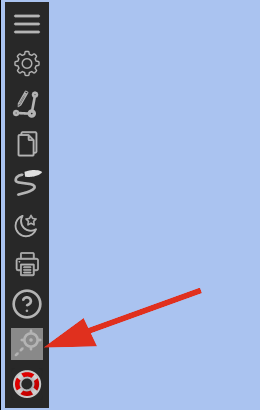

The panel has four boxes, top to bottom — **Own ship**, **Report**,
**Target drift**, **Result** — and three display checkboxes underneath.
Every field shows a short explanation when you hold the mouse over it.

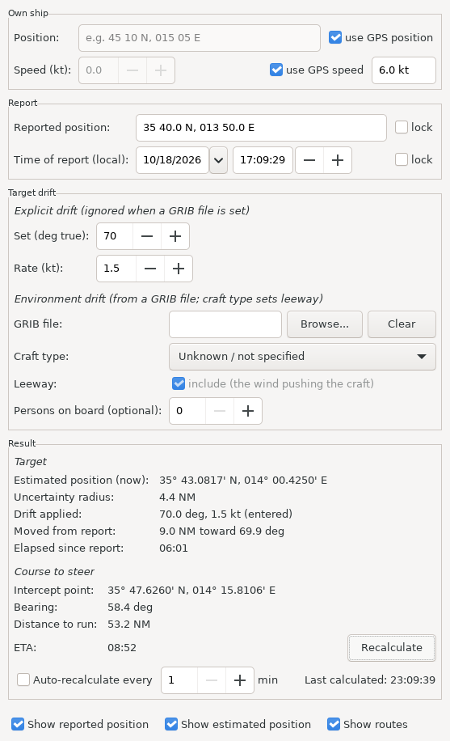

On a small screen the panel is never taller than the screen: scroll inside
it to reach the lower boxes. Scrolling with the mouse wheel over a number
field scrolls the panel; it only changes the number once you have clicked
into that field.

The panel is in English: the plugin has no translations yet. Dialog
buttons such as "OK" follow your OpenCPN language, as everywhere else.

## 2. Own ship

Where you are steering from, and how fast you go.

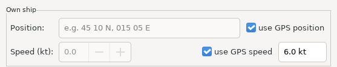

| Field | What it does |
|---|---|
| **Position** | Your position. With **use GPS position** ticked (the default) the plugin uses OpenCPN's live GPS position and the field is greyed out. Untick it to type a position yourself — for example to plan from a position you are not at yet. |
| **Speed (kt)** | Your speed over ground, in knots. With **use GPS speed** ticked (the default) the plugin uses the speed OpenCPN gets from the GPS. Untick it to type a speed — useful when the GPS gives no speed, or you want to plan with the speed you intend to make rather than the one you are making. |
| **GPS speed** (read-only, right of "use GPS speed") | The speed the GPS is reporting right now, so you can decide which to use. `--` means there is no GPS speed: untick "use GPS speed" and enter one. |

When you untick one of the two and its field is still empty (or the speed
still 0), it is filled in with the current GPS value, so you only need to
adjust it.

Without a speed the plugin still shows the bearing and distance to the
target, but it cannot work out an intercept or an ETA.

## 3. Report

Where and when the target was last reported.

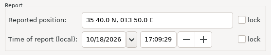

**Reported position** — latitude, then longitude, separated by a comma. Any
of these forms works:

| Form | Example |
|---|---|
| Decimal degrees | `45.508, 15.338` or `-33.5, -70.6` |
| Degrees and decimal minutes | `45 30.5 N, 015 20.3 E` |
| Degrees, minutes and seconds | `45 30 30 N, 015 20 18 E` |
| As OpenCPN shows positions | `45° 30.5000' N, 015° 20.3000' E` |

So you can copy a position from OpenCPN — for example from a mark's
properties — and paste it straight in. Without a comma, the split falls
after the N or S.

**Time of report (local)** — the date and time of the report, in your
computer's local time. The time since then is how long the target has been
drifting.

**lock** — ticking it greys the field out so a later edit can't change it
by accident.

## 4. Target drift

How the target has been moving since it was reported. There are two ways to
say it; if you give a GRIB file, it wins.

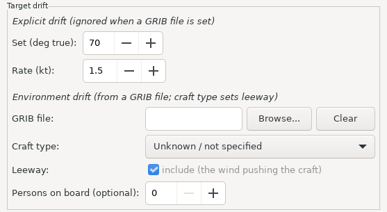

### Explicit drift

If you know the drift — from an observation, a drift buoy, local
knowledge:

- **Set (deg true)** — the direction the target is drifting **toward**,
  0–359.
- **Rate (kt)** — how fast. `0` means no drift: the estimated position stays
  at the reported one.

These two fields are greyed out while a GRIB file is set.

### Environment drift (GRIB file)

Instead of a drift, give the plugin the weather and sea it drifted in:

- **GRIB file** — **Browse…** picks a GRIB2 file (`.grb`, `.grb2`, `.grib`,
  `.grib2`, `.gr2`, `.bin`) with 10 m wind and/or surface current covering
  the area and the time since the report. **Clear** removes it again.
  The plugin reads the file itself; OpenCPN's GRIB plugin is not needed,
  and a file downloaded ashore works offline.
- **Craft type** — sets how strongly the wind pushes the target
  (*leeway*): a rubber boat or inflatable is pushed harder than a wooden
  displacement hull. **Unknown / not specified** uses the rubber-boat
  figures, the more cautious choice.
- **Leeway: include** — ticked (the default), the target drifts with the
  current plus the wind's leeway. Untick it to use the current alone: the
  leeway figures are not verified, so if you don't trust them you can
  leave them out. The uncertainty ring then grows — the wind still pushes
  the target, the plugin just doesn't estimate how much. Only available
  with a GRIB file.
- **Persons on board (optional)** — recorded with the case; it does not
  change the calculation.

The target is then moved by the current plus the wind's leeway, step by
step through the time since the report. Where the file has no wind or no
current, that part counts as zero drift — and as unknown, which makes the
uncertainty circle larger (see below).

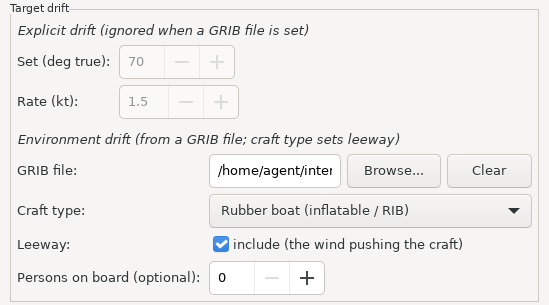

## 5. Calculating

Press **Recalculate** (in the Result box, next to ETA). The plugin ages the
reported position to the current time, works out the intercept from your
current position, and redraws the chart. Press it again whenever you change
an input — or let it run on its own:

**Auto-recalculate every _N_ min** — tick it and the plugin recalculates
every _N_ minutes (1–60), with the live GPS position and the current time,
exactly as if you pressed the button. It starts with one calculation
straight away and keeps going while the panel is closed, so the chart stays
current. **Last calculated** shows when it last ran.

An automatic run never opens a dialog box. If an input is invalid, or you
are still typing a position, it skips that run, leaves the last result on
the chart, and says why in red under the row. Auto mode stays on and picks
up again once the input is valid. (Pressing Recalculate yourself with an
invalid input shows the error in a dialog.)

## 6. Reading the result

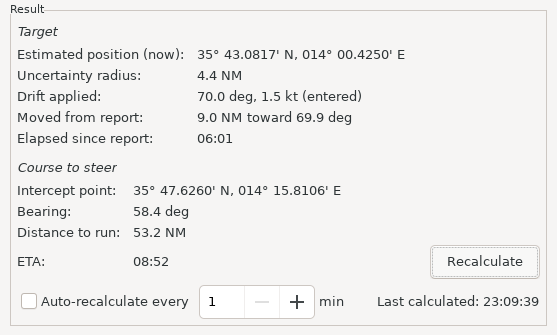

### Target

| Row | Meaning |
|---|---|
| **Estimated position (now)** | Where the target is estimated to be at the time of the calculation. Shown in the latitude/longitude format chosen in OpenCPN's options. |
| **Uncertainty radius** | How far from that estimate the target may be — see below. Drawn on the chart as a ring around the estimated position. |
| **Drift applied** | Where the drift came from: the entered set and rate, "from GRIB file", "from GRIB file, current only (leeway off)", or none. |
| **Moved from report** | How far, and in which direction, the estimate has moved from the reported position. |
| **Elapsed since report** | How long the target has been drifting (hours:minutes). |

**The uncertainty radius** follows the IAMSAR method: the error of the
reported position itself, plus a drift error that grows with time, plus —
with a GRIB file — an allowance for the wind pushing the target to either
side of straight downwind. It grows the longer ago the report was, and it is
larger when the drift is only estimated (entered by hand, or missing from
the GRIB file) than when the GRIB covers both wind and current. The default
error values are unverified; see
[LEEWAY_NEEDS_VERIFICATION.md](LEEWAY_NEEDS_VERIFICATION.md).

### Course to steer

The target keeps drifting while you are on your way, so the plugin does not
send you to where it is now, but to where you will meet it.

| Row | Meaning |
|---|---|
| **Intercept point** | Where you meet the target if you steer this course at your speed and it keeps drifting as estimated. |
| **Bearing** | The course to steer, degrees true. |
| **Distance to run** | How far you have to go. |
| **ETA** | How long until you meet (hours:minutes). |

**When there is no intercept.** Sometimes you cannot meet the target: your
speed is not known, or the target drifts away faster than you can follow.
Then:

- **Intercept point** says why: "own-ship speed not set" or "own ship can't
  catch up".
- **Bearing** and **Distance to run** are to the estimated position *now* —
  a direction to head in, not a meeting point.
- **ETA** reads "-- (no intercept)".

A target that is faster than you can still be met if it is drifting toward
you or across your path; the plugin finds that meeting too.

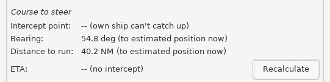

## 7. On the chart

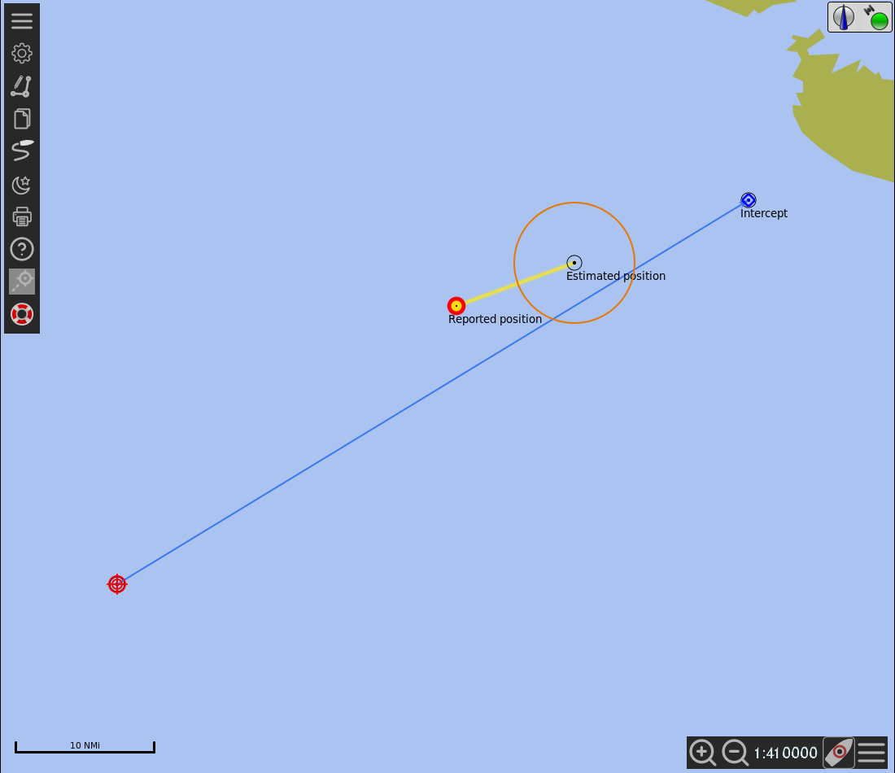

| Object | What it shows | Shown when |
|---|---|---|
| **Reported position** mark | Where the target was reported. | "Show reported position" ticked |
| **Estimated position** mark (circle) | Where the target is estimated to be now. | "Show estimated position" ticked |
| **Uncertainty ring** around it | The uncertainty radius. | with the Estimated position mark |
| **Target drift** track | From the reported position to the estimated one. | "Show routes" ticked, and the target has drifted |
| **Course to steer** route | From your position to the intercept point. Called "Toward estimated position (no intercept)" when there is no intercept. | "Show routes" ticked, and your position is known |
| **Intercept** mark (diamond) | The meeting point. | "Show routes" ticked, and there is an intercept |

The three checkboxes at the bottom of the panel show and hide these
straight away, without recalculating.

**Navigating with them.** The "Course to steer" route is an ordinary
OpenCPN route: you can activate it, or use "Navigate to" on a mark, and
OpenCPN (and an autopilot it drives) follows it. While you navigate along
the route or to one of the plugin's marks, recalculating does not cancel
that: the object stays where it is, and the panel says so — the numbers in
the panel keep updating. The Estimated position mark is the exception: it
and its ring are moved to the new estimate without interrupting
navigation.

**Ring size and units.** OpenCPN draws the uncertainty ring in the unit you
chose for waypoint range rings in its options (nautical miles or
kilometres); the plugin converts the radius to that unit. If you change that
setting, OpenCPN may only pass the new unit on after it has saved its
settings — restart OpenCPN if the ring looks the wrong size.

The objects exist only while OpenCPN is running. They are not saved to your
routes and marks, and they disappear when you disable the plugin or close
OpenCPN.

## 8. A worked example

This is the case in the screenshots: a demonstration south-west of Malta
with a test GRIB file, not real data.

1. A rubber boat was reported at **35° 40.0' N, 013° 50.0' E** six hours
   ago. You are south-west of it at 35° 20' N, 013° 20' E, making **6 kt**
   on GPS.
2. Open the panel. Leave **use GPS position** and **use GPS speed** ticked;
   the field next to "use GPS speed" shows 6.0 kt.
3. Enter the reported position and the time of report.
4. You have a GRIB file for the area: **Browse…** to it, and set **Craft
   type** to *Rubber boat (inflatable / RIB)*.
5. Press **Recalculate**. The Result box shows the estimated position about
   4 NM south-east of the report, an uncertainty radius of about 6 NM
   (2 NM of it for leeway divergence), and the intercept: a bearing of about
   064°, 33 NM to run, ETA about 05:30.
6. On the chart: the drift track from the reported position, the estimated
   position with its ring, and the course line to the intercept mark.
7. Tick **Auto-recalculate every 5 min** and activate the "Course to steer"
   route. The estimate, the ring and the numbers keep updating as you go.

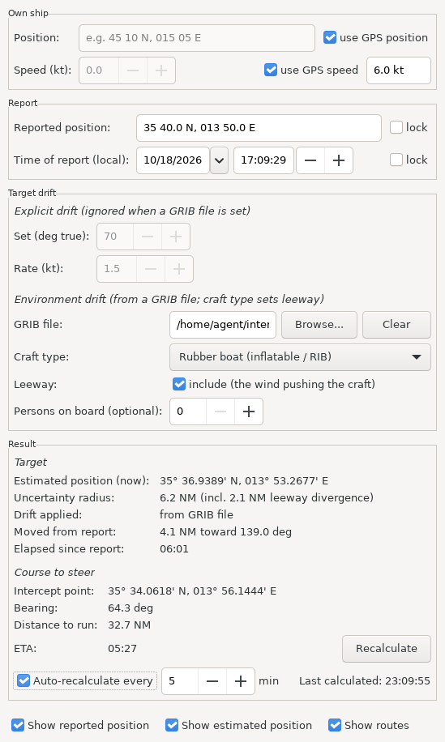

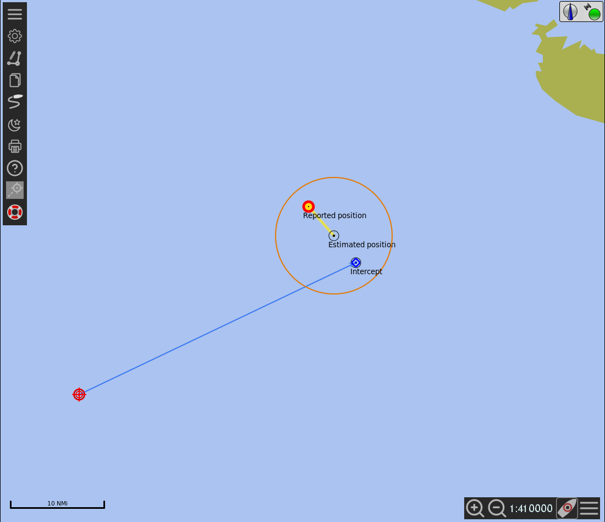

## 9. Troubleshooting

**"… is not valid: …" when I press Recalculate.** The position could not be
read. The message says which part. Common causes: latitude and longitude the
wrong way round (latitude comes first), a hemisphere letter missing from a
degrees-and-minutes position (`45 30.5` needs `N` or `S`), or minutes of 60
or more.

**A red line under Auto-recalculate.** An automatic run was skipped; the
line says why. The chart keeps the last good result until the next run
succeeds.

**No intercept, no ETA.** See [When there is no intercept](#course-to-steer):
your speed is unknown (`--` next to "use GPS speed" — enter one by hand), or
the target drifts away faster than you can follow.

**The route stopped updating.** You are navigating along it, so the plugin
leaves it alone instead of cancelling your navigation; the panel says so.
Deactivate the route in OpenCPN, and the next calculation replaces it.

**The ring is the wrong size.** See *Ring size and units* above.

**The panel doesn't fit on the screen.** Scroll inside it, or make it
smaller — it scrolls instead of being cut off.

**The plugin doesn't appear at all.** See [INSTALLING.md](INSTALLING.md).
OpenCPN's log file lists plugin loading errors.

## 10. Limitations

- **Not verified.** The drift model and the uncertainty defaults need a
  search-and-rescue expert's review —
  [LEEWAY_NEEDS_VERIFICATION.md](LEEWAY_NEEDS_VERIFICATION.md) lists what is
  still a guess.
- **Two craft types only.** Real leeway depends on the exact kind of
  object; the plugin only distinguishes rubber/inflatable and wooden
  hulls.
- **Pure downwind leeway.** The estimate assumes the wind pushes the target
  straight downwind. Real objects drift off to one side; the uncertainty
  ring allows for that, the estimated position itself does not.
- **The reported position's own error is a fixed 1 NM.** A GPS-fixed report
  is far more precise than that, a dead-reckoned one far less.
- **No search patterns yet.** Expanding square, sector and parallel-track
  searches are planned.
